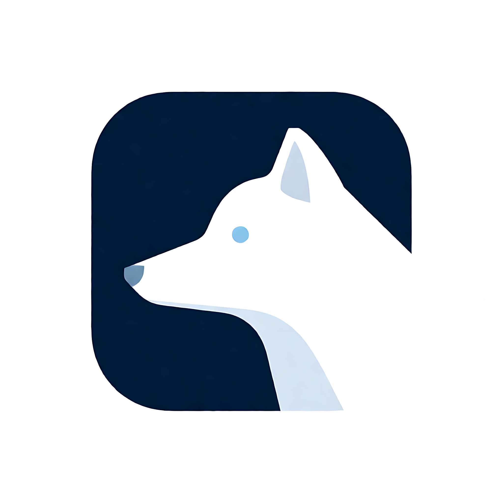

  

<h1 align="center">凛狐 Rimefox · 双语对照翻译</h1>

  
  
  

用自己的 API Key 做整页双语对照翻译，不经过任何作者服务器。

凛狐（Rimefox）是一个 Chrome / Edge 通用的网页翻译扩展（Manifest V3）：**只用你自己的 API Key**，不接第三方免费端点，也不向作者服务器发送任何内容。纯原生 JavaScript，零构建，改完刷新即可使用。

*Rimefox is a bring-your-own-key bilingual translation extension for Chrome and Edge (Manifest V3).*

## 核心功能

- **整页双语对照** —— 原文与译文分层显示，多种译文样式，双语 / 仅译文一键切换
- **行内格式保真** —— 局部加粗、斜体、代码、删除线、高亮、引号、按键、上下标和普通链接随译文保留，参考文献与图表链接仍可点击
- **自己的接口** —— DeepSeek、智谱 GLM、通义千问、Kimi、硅基流动、OpenRouter、Ollama、Anthropic、Gemini，以及任意 OpenAI 兼容网关
- **省 token、防限流** —— 懒翻译（只翻屏幕附近）、批量合并、并发控制、三层缓存、429/5xx 自动重试
- **动态页面** —— MutationObserver 补翻新内容，SPA 路由切换后自动重翻
- **阅读辅助** —— 悬停对照、划词翻译、输入框翻译（`Alt+I`）、置顶翻译小窗、网页悬浮入口（默认关闭）
- **YouTube 字幕双语** —— 打开 CC 时显示「原文 + 译文」（非官方功能，默认关闭）
- **可选隐私保护** —— 发请求前在本地把邮箱、电话、身份证号、银行卡号换成占位符，译文回来后还原（默认关闭）
- **术语表与提示词** —— 设置首选译法，可加说明区分适用语境与例外；无说明的旧词条保持固定译法，详见[术语表帮助](docs/GLOSSARY.md)。也支持追加措辞要求和趣味风格
- **自定义目标语言** —— 内置语言之外可添加名称、标准代码和说明；无代码的虚构语言安全降级，阿拉伯语等 RTL 排版正常
- **AI 精翻** —— 可选地把标题、章节和同文章相邻段落作为有限上下文并入正常请求，不额外增加模型调用；隐私脱敏开启时不发送（默认关闭）
- **医学专业模式** —— 全局开关，优先使用已审核的医学 / 临床研究术语，保留剂量、统计结果和临床结论（默认关闭）
- **外观可调** —— 浅色 / 深夜配色、强调色、液态玻璃（导航 / 滑块 / 开关）、译文字号与行高、深色网页适配、站点规则、网页夜间模式（Beta）、译文自定义 CSS
- **中英文界面** —— 设置页与弹窗支持中文 / English
- **零构建** —— 不需要 npm、webpack 或编译步骤，直接加载本目录即可

## 安装

从本仓库的 **Releases** 页面下载 `Rimefox-v<版本号>.zip`，解压后按下表加载解压出来的 `Rimefox` 文件夹；直接用仓库源码也可以。

| | Chrome | Edge |
|---|---|---|
| 1. 打开扩展管理页 | 地址栏输入 `chrome://extensions/` | 地址栏输入 `edge://extensions/` |
| 2. 打开开发者模式 | 右上角「开发者模式」 | 左下角「开发人员模式」 |
| 3. 加载扩展 | 「加载已解压的扩展程序」，选择解压出的 `Rimefox` 文件夹 | 「加载解压缩的扩展」，选择解压出的 `Rimefox` 文件夹 |

> **升级**：把新版本覆盖到同一个文件夹再点「重新加载」。已解压扩展的 ID 与文件夹路径绑定，路径不变，设置和 API Key 才会保留。

从 **0.4.7 或更早的 DualTrans** 升级、或想用配置导出 / 导入迁移，见 [docs/UPGRADING.md](docs/UPGRADING.md)。

## 快速开始

1. 首次安装会自动打开欢迎页，跟着引导点「打开设置」。在「提供商」里选一个服务（或「＋ 新建自定义服务商」），填好地址和 Key
2. 点「获取模型列表」选一个模型，再点「测试连接」确认能通
3. 打开任意网页，点工具栏图标或按 `Alt+A`（Mac：`Option+A`）翻译；再按一次还原原文。要翻输入框里的内容，按 `Alt+I`（Mac：`Option+I`）就地翻译，`Ctrl+Z` 撤销
4. 快捷键没反应时，看设置页「浏览器快捷键」：显示「未设置」说明组合键被其它扩展占用，点「去浏览器里设置」换一个

> Chrome 会把新扩展收进工具栏的拼图图标里，点旁边的图钉固定出来更方便。想翻本地 `file://` 页面，需要在扩展「详细信息」里打开「允许访问文件网址」。
>
> 欢迎页只在首次安装时自动打开；之后可以从设置页侧栏或弹窗底部的「指南」重新查看。

## 文档

| 文档 | 内容 |
|---|---|
| [HANDOFF.md](HANDOFF.md) | 开发交接：架构、消息协议、踩坑清单、调试与发版流程 |
| [docs/TRANSLATION-ENGINE-HANDOFF.md](docs/TRANSLATION-ENGINE-HANDOFF.md) | 翻译引擎：单元模型、渲染事务、句子对齐、接手指南 |
| [docs/SHADOW-DOM-ADAPTER.md](docs/SHADOW-DOM-ADAPTER.md) | 开放 Shadow DOM / Bilibili 评论区适配与后续站点接入 |
| [docs/PROFESSIONAL-TRANSLATION.md](docs/PROFESSIONAL-TRANSLATION.md) | 医学专业模式：开关、词库来源、提示词、缓存隔离、测试与限制 |
| [docs/ROADMAP.md](docs/ROADMAP.md) | 优先级、已完成 / 待办、明确不做的清单 |
| [docs/UPGRADING.md](docs/UPGRADING.md) | 从旧版 DualTrans 升级与配置迁移 |
| [docs/YOUTUBE.md](docs/YOUTUBE.md) | YouTube 字幕双语的限制、风险与隐私说明 |
| [docs/archive/](docs/archive/README.md) | 归档：审计报告、评估、历史验证记录（不是现状） |
| [PRIVACY.md](PRIVACY.md) · [English](docs/privacy.en.md) | 隐私说明：会发送什么、保存在哪里 |
| [SECURITY.md](SECURITY.md) | 安全问题如何私下报告 |
| [docs/STORE.md](docs/STORE.md) · [STORE-EDGE.md](docs/STORE-EDGE.md) | 上架材料：Chrome 与 Edge |
| [CHANGELOG.md](CHANGELOG.md) | 每个版本的变更 |

## 支持范围

- Chrome 114+ / Edge 114+，Manifest V3
- 视频字幕只支持 YouTube 的 CC 字幕轨道；画面硬字幕、PDF / EPUB、图片 OCR 不做
- 行内格式做有限保真：局部加粗、斜体、代码、删除线、高亮、下划线、引号、按键、小字、上下标、局部颜色和普通链接可随译文保留；复杂链接或无法可靠对应的结构会保留原文，必要时在设置页写站点规则
- 开放 Shadow DOM：已适配 B 站新版评论区正文；closed Shadow Root、shadow root 直接文本、iframe 内评论区暂不支持
- B 站未登录时只展示首屏评论和“登录后查看”提示，滚动加载 / 楼中楼展开需要在登录态下验证

完整清单见 [ROADMAP.md 的「已知限制」](docs/ROADMAP.md) 与 [HANDOFF.md 的「已知问题」](HANDOFF.md)。

## 声明

本项目为**独立实现**，与任何商业产品无关联；除 [THIRD-PARTY-NOTICES.md](THIRD-PARTY-NOTICES.md) 中注明的 MIT 许可复用内容外，不含其他第三方产品的代码、图标或文案。YouTube 字幕是**非官方**功能，与 YouTube、Google 无关联；YouTube 是 Google LLC 的商标。

所有翻译请求只发往**你自己配置的接口**，不经过本项目作者的服务器；API Key 只保存在本机浏览器的 `chrome.storage.local` 中。

## 致谢

弹窗底部的液态玻璃工具坞复用自 [Sak（@Saknutella）的 Liquid Glass Slider](https://github.com/Saknutella/liquid-glass-slider)（MIT）。感谢 Sak 把位移折射、三通道色散和这套弹簧手感开源出来。

## 许可

[MIT](LICENSE)。第三方来源与许可证说明见 [THIRD-PARTY-NOTICES.md](THIRD-PARTY-NOTICES.md)。
