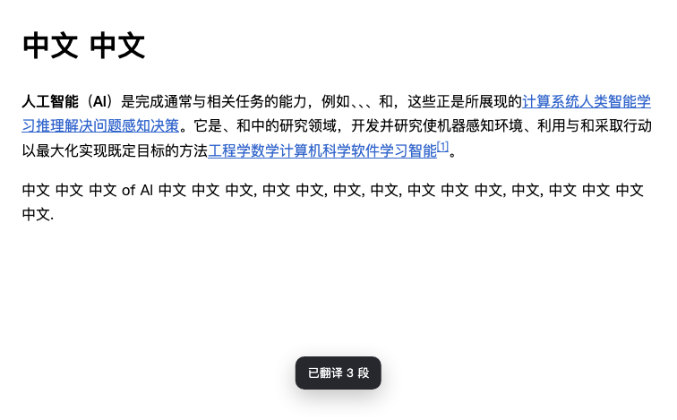
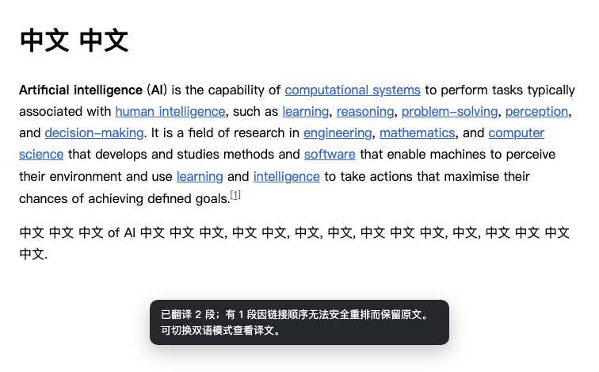
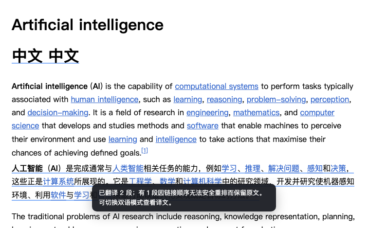

# 0.12.2 链接顺序专项：本地修复与 QA 交付

> 已归档。开发开始于2026-10-24，完成于2026-10-25。当前契约见[翻译引擎 §3.6](../TRANSLATION-ENGINE-HANDOFF.md#36-原子顺序与渲染成功契约)。本轮只在本地 main 提交，不推送、不创建 Release、不改商店或正式版本安排。

## 基线与交付位置

完整阅读独立QA报告 `edge-bilingual-qa-0122/qa/QA-REPORT-LINK-ORDER-0.12.2.md` 后，重新fetch确认本地main与origin/main均为 `813c87f6a2703aa88c42ec8480a79ff0490efc58`，工作区干净，与QA被测版本相同。没有回退、reset、clean或覆盖既有提交；另外两个工作树保持原状，QA克隆只读。

实现提交：`0de4616f767ff7829272f75cd413a6e1f8611c3f`。本报告和补齐的QA模式矩阵另作本地提交；最终本地main SHA见交付消息或 `git rev-parse main`。版本三处仍为0.12.2，CHANGELOG未改写已经存在的发布记录。

## 对交付问题的直接回答

| 问题 | 结果 |
|---|---|
| 1. 是否消除silent success？ | 已消除本轮确认的渲染器顺序损坏路径：目标原子逆序/跨行预检拒绝，物理gap与标签不符事务回滚，失败不计成功；这不是对任意模型语义正确性的保证。 |
| 2. 仅译文能否通用重排原链接？ | 不能。本轮不搬原A、不克隆替换原A；无法可靠呈现目标顺序时保留整段原文，提示用户主动切双语。 |
| 3. 具体结构限制？ | 普通链接、xref、提及、保护内容、控件、混合Ruby等不能被任意重排；跨硬行、共享强调壳使gap落点错位、标签无法正确写到可见文字等也明确失败。 |
| 4. 何时正常注入/保留原文？ | 目标token序与源原子顺序兼容且实际DOM计划可验证时注入；正常相邻原子和引用共址允许；逆序/跨行/落点或标签不可实现时保留原文。仅文献引用受限同句兼容定位可safe-degraded。 |
| 5. 用户看到什么？ | toast示例：“已翻译2段；有1段因链接顺序无法安全重排而保留原文。可切换双语模式查看译文。”popup同时显示“保留原文1”和具体原因。 |
| 6. 是否增加API请求？ | 不为DOM不兼容追加模型调用，不进入付费退避；同页补扫不重试。测试只调用本地假API，没有真实付费调用。 |
| 7. 有效模型缓存能否复用？ | 可以。inline-v1及缓存身份不变，不驱逐有效重排响应，不全量清缓存；英/阿文失败后切双语、切回、明确重翻均复用缓存，0次新增请求。 |
| 8. 是否保留链接和事件？ | 原A对象、全部属性及事件保留，不移动/重建源链接；所有原链接监听逐一验证。双语目标副本延续既有机制，源交互节点不动。 |
| 9. 原文能否正确还原？ | 正常注入、失败、模式切换、故障回滚均检查outerHTML和全节点身份；框架产生的新源节点/文字恢复时也保留，不复活旧源。 |
| 10. 现有E2E是否通过？ | 完整Chrome277/277；原Inline Layout三视口均557/557；离线267/267；新增专项368/368。全部Node文件顺序执行通过。 |

## 修复前后与固定响应

基线使用只读QA克隆和原driver重放，全部为随机端口、独立Chrome Profile、本地假API。原QA HTML及6份JSON响应逐字复制到 `test/fixtures/link-order/`，哈希与来源见[provenance](2026-10-25-link-order-evidence/provenance.json)，没有修改响应来迎合实现。重放原始记录见[before](2026-10-25-link-order-evidence/before-replays.json)及[after](2026-10-25-link-order-evidence/after-replays.json)。

| 固定响应 | 修复前 | 修复后 |
|---|---|---|
| Control | 单调顺序可正常渲染 | 双语和仅译文均保持正确可见文字、链接目标对应 |
| Reorder（英文/阿文） | 仅译文把多个正文链接堆句末，renderFailed=0，translated=3 | 仅译文unsupported-inline-order，整段原样，translated=2/renderFailed=1；双语准确呈现目标token序 |
| Tail | 忠实渲染模型自身尾置，但无警告 | 不擅自改模型顺序；正文链接从分散变句末聚簇时显式质量警告，不宣称语义已验证 |
| MissingOne | missing-marker拒绝 | 双语/仅译文继续安全拒绝，未放宽协议保护 |

正文“例如、、、和”与译文标签堆句末不再由渲染器自行制造。相同stripped偏移也能交换两个链接：本轮保留目标token原始序，修正双语原本按源id排回的错误。

### 截图

修复前，英文重排被记为成功：



修复后，仅译文保留完整原段并明确提示：



用户主动切双语后按模型语序显示，复用缓存：



实际popup提示见[截图](2026-10-25-link-order-evidence/after-popup.png)；阿文[修复前](2026-10-25-link-order-evidence/before-ar-reorder.png)与[修复后](2026-10-25-link-order-evidence/after-ar-reorder.png)也已保留。

## 实际修改文件

- 运行时：`content/dom.js`、`content/units.js`、`content/main.js`、`popup/popup.js`、`lib/i18n.js`。
- 回归入口：`selftest/index.html`、`selftest/test.js`、新增`selftest/link-order.js`、`test/content-main.test.mjs`、`test/i18n.test.mjs`、新增`tools/e2e-link-order.mjs`。
- 固定数据：新增`test/fixtures/link-order/README.md`、`pages/`中的三份HTML与`replies/`中的六份原始JSON，逐文件哈希列于provenance。
- 文档与证据：`HANDOFF.md`、`docs/ROADMAP.md`、`docs/TRANSLATION-ENGINE-HANDOFF.md`、`docs/archive/README.md`、本报告及同目录`2026-10-25-link-order-evidence/`的截图/JSON。
- `manifest.json`、`content/core.js`、`package.json`、`CHANGELOG.md`、后台与协议校验代码均未修改。

## 实现与边界

- `content/units.js`：legacy `keepMarks`新增实际标记order，避免去掉标签后相同偏移丢失先后；保留公开keepPlacement兼容API。
- `content/dom.js`：统一replaceMode进入mixed预检；普通正文原子不能套用引用句末吸附。引用正常共址可exact，仅受限同句兼容为safe-degraded，跨句/硬行不能偷偷改所引陈述。双语同偏移按目标token序。
- mixed事务内还核对计划的gap/原子节点身份顺序、实际文字及可见标签，防共享strong/span壳把正文移到链接前；隐藏文字标签不可写时明确unsafe-structure并整笔回滚。所有修改继续使用既有RenderTransaction，false/throw均撤回，不产生部分移动链接或半句替换。
- 旧源Text快照无法发现既有空span新添文字，因此补齐仅待写入阶段的token全集预检，局部段按段界隔离；不参与已渲染兄弟段释放。失败回滚恢复原renderMode，故障后同unit不能绕过新源检查。
- `content/main.js`：unsupported-inline-order属于render失败，不属于provider失败，也不计translated/skipped；独立计数和质量提示。整P被框架replaceWith后，当前失败索引释放失联节点的旧计数，诊断不复制正文。
- `popup/popup.js`与`lib/i18n.js`：延续现有状态卡和toast，显示保留原文、安全调整及链接/引用质量提示，中英文都有映射，没有新增控制面板。

Tail只做窄范围可疑检测：原本隔着正文的至少三个普通链接被模型连续聚到同一句末。它不判协议无效、不猜跨语言词序、不改缓存、不把正常相邻链接或正常上标引用共址误杀。模型仍可能给出结构正确但语义错误的其他译文，不能承诺自动证明所有语言质量。

## 测试与独立复核

已执行：

```sh
for f in test/*.test.mjs; do node "$f" || exit 1; done
node tools/e2e-extension.mjs
node tools/e2e-inline-layout.mjs
node tools/e2e-link-order.mjs --out /tmp/rimefox-link-order-replay
python3 tools/check-release-notes.py 0.12.2
git diff --check
```

全部Node文件为41个，含新增调度分类/计数/动态移除和英文UI断言；content-main为55项。关键JS语法检查通过。按CI相同的file:// + 5000ms虚拟时间Chrome命令也267/267通过。

专项包括固定四组响应两种模式、英文和阿文密集链接；DOM矩阵覆盖中→英、RTL/LTR混排、嵌套span/strong、多个句子、两链接交换/单链接移动、相邻同名链接与不同href、引用共址/跨句/跨硬行、notranslate/提及/xref/控件、故障回滚及动态更新。断言同时检查文本、href对应、真实对象身份、原A所有监听及精确还原，不以链接数量取绿。

独立复核额外复现并确认修复：相邻交换的双语tie、共享强调壳错位、跨硬行引用、整节点替换后旧失败计数、whole及共享段空shell新源Text。原始探针结果见[独立复核证据](2026-10-25-link-order-evidence/independent-review.json)。本地全部正式回归没有未解释失败。

既有FAQ/段内按钮、SUP/SUB比例、字体、RTL、模式切换、自定义语言、术语说明、趣味风格/猫娘/强度/持久化、AI精翻、隐私、语言守卫、缓存和异常输出均由原全量Node/E2E保留，没有为本轮修改协议或放宽输出校验。

未验证：用户实际安装扩展的profile/版本、本轮未授权的真实付费模型、实时站点未来DOM变化、所有React/Vue页面。使用的是QA冻结的真实页面结构与录制输出，不把离线抓取夹具说成实时站点全覆盖。

## 真正仅译文重排的研究结论

| 方向 | 事件/身份 | CSS、观察器、框架与恢复 | 本轮决定 |
|---|---|---|---|
| 事务移动原A | 同一对象可保留href和直接监听 | 祖先链/事件委托/nth-child、focus/selection、框架vnode顺序及childList观察仍会改变；恢复必须识别站点后续修改 | 不通用启用 |
| 新译文视图，隐藏源DOM | 可保留源对象，但新副本不继承addEventListener | 事件转发不能完全复制isTrusted、键盘、焦点、默认动作和a11y；隐藏源结构也影响站点状态 | 需独立可选视图设计，不能自动把仅译文变双语 |
| 严格受限平坦静态结构 | 可尝试同父原A移位 | 必须快照anchors/CSS/交互、校验每步/恢复、发现框架修改即中止，仍无法证明无外部引用 | 建议独立实验与opt-in，不在本轮冒险 |
| 不可实现时明确失败 | 源A完全不动 | 失败段原样，用户可主动双语；通过缓存不重复付费 | 本轮采用 |

[Chrome的moveBefore说明](https://developer.chrome.com/blog/movebefore-api)提供保状态移动能力，但项目最低Chrome114不能无条件依赖；即使feature-detect，也不能解决全部框架/CSS/观察器语义。这里只是未来受限方案的技术候选，不是本轮实现或通用安全承诺。

## 最小复现与复测入口

固定原文/响应：`test/fixtures/link-order/pages/wiki-ai-p1-events.html` 与 `replies/order-reorder.json`；阿文为 `wiki-ar-p1.html` 与 `ar-reorder.json`。执行专项runner即可加载实际本地扩展并逐字重放，无需Key。证据JSON包含实际extensionPath、extensionId、浏览器、响应、状态、诊断、请求计数及截图路径。

适合交回独立QA复测：重点复核Reorder保留整段且明确失败、Tail警告、MissingOne不放宽、双语缓存顺序和动态页面恢复。版本仍0.12.2，是否安排后续发布由用户决定；本轮没有push或商店操作。
